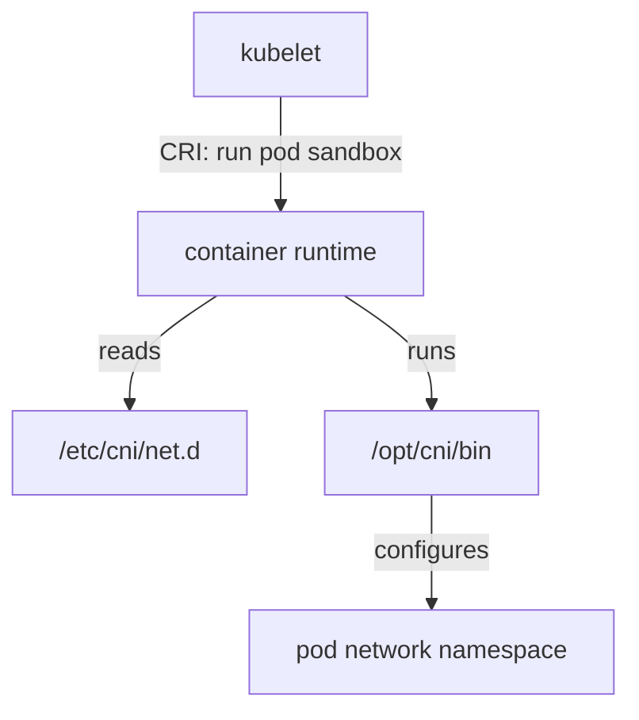

# The CNI Configuration And Binary Directories

When Kubernetes starts a pod, the pod sandbox has an empty network namespace. A network namespace is a Linux kernel object that holds its own network interfaces, routing table and firewall rules. Something must create an interface in that namespace and give it an address. That work belongs to a CNI plugin, and this part explains how the container runtime on a node finds the plugin and its settings before it calls it.

## Who calls the plugin

A container runtime is the program on a node that creates containers, for example containerd or CRI-O. The kubelet is the agent on each node that asks the runtime to start pods through the Container Runtime Interface (CRI). The kubelet does not run CNI plugins. The runtime does. Older Kubernetes versions had kubelet flags for the CNI directories, but they were removed in Kubernetes 1.24, so the directories are now settings of the runtime.

This matters when you troubleshoot. If a pod stays in `ContainerCreating` because of a network error, the message comes from the runtime, and the files that decide the result are on the node, not in the Kubernetes API.



The diagram shows that the kubelet only talks to the runtime. The runtime reads the configuration directory, runs a binary from the binary directory and that binary configures the network namespace of the pod.

## The two directories

The default CNI configuration directory is `/etc/cni/net.d`. It holds the files that describe which plugin to run and with which settings. The default CNI binary directory is `/opt/cni/bin`. It holds the executable files of the plugins. Both directories are paths on the node itself. A plugin installer, such as a DaemonSet, reaches them through `hostPath` volumes.

A kind node image ships a few reference plugins in `/opt/cni/bin`: `host-local`, `loopback`, `ptp` and `portmap`. The playground also installs the other reference plugins, such as `bridge`, because flannel needs the `bridge` plugin. The directory is shared by all plugins, so a plugin from one project can sit next to a plugin from another.

## Configuration files

The runtime reads files with the extensions `.conf`, `.conflist` and `.json` from the configuration directory. A `.conf` file holds the configuration of one plugin. A `.conflist` file holds a network configuration with a list of plugins that run one after another. The list form is common today because most clusters need more than one step: an interface, then port mappings, then maybe bandwidth limits.

A network configuration has these top-level fields.

- `cniVersion`: the version of the CNI specification the file follows.
- `name`: the name of the network. The name is a label for the network, not a Kubernetes object.
- `plugins`: the ordered list of plugin configurations in a `.conflist` file.
- `disableCheck`: when true, the runtime must not call `CHECK` for this network.

Each entry in `plugins` has a `type` field. The `type` is the file name of the binary that the runtime runs from the binary directory. The other fields of the entry are settings of that plugin. The next section reads a real file.

## The flannel configuration

Flannel keeps its CNI configuration in a ConfigMap and copies it to every node. The ConfigMap `kube-flannel-cfg` in the namespace `kube-flannel` has the key `cni-conf.json`. Read it first.

<!-- astrona:playground:renew -->
```sh
kubectl -n kube-flannel get configmap kube-flannel-cfg -o jsonpath='{.data.cni-conf\.json}'
```

The command prints this JSON from the flannel v0.28.10 manifest:

```json
{
  "name": "cbr0",
  "cniVersion": "1.0.0",
  "plugins": [
    {
      "type": "flannel",
      "delegate": {
        "hairpinMode": true,
        "isDefaultGateway": true
      }
    },
    {
      "type": "portmap",
      "capabilities": {
        "portMappings": true
      }
    }
  ]
}
```

The network is named `cbr0` and follows CNI specification 1.0.0. The chain has two plugins. The runtime runs the binary `flannel` first and then the binary `portmap`. The `delegate` object holds settings that flannel hands to the plugin it delegates to. The `capabilities` object tells the runtime to pass port mappings from the pod definition to `portmap`.

## How the file reaches the node

The DaemonSet `kube-flannel-ds` runs one pod per node. Two init containers run before the main container. An init container is a container that runs to completion before the main containers start. Print their names and arguments.

```sh
kubectl -n kube-flannel get daemonset kube-flannel-ds -o jsonpath='{range .spec.template.spec.initContainers[*]}{.name}{": "}{.args}{"\n"}{end}'
```

The first init container, `install-cni-plugin`, copies the `flannel` binary from its image to `/opt/cni/bin/flannel`. The second, `install-cni`, copies `/etc/kube-flannel/cni-conf.json` to `/etc/cni/net.d/10-flannel.conflist`. The source path is the mounted ConfigMap, and the target path is the `hostPath` volume of the node. The file name on the node is therefore chosen by the last argument of that command, not by the ConfigMap.

## Looking at the node

You can open a shell with the node file system with `kubectl debug`. It starts a pod on the node and mounts the node root file system at `/host`. First store the name of a node.

```sh
NODE="$(kubectl get nodes -o jsonpath='{.items[0].metadata.name}')"
kubectl debug node/"$NODE" -it --image=busybox:1.37 -- ls /host/etc/cni/net.d /host/opt/cni/bin
```

The first directory listing includes `10-flannel.conflist`. The second listing includes `flannel`, `bridge`, `host-local`, `loopback` and `portmap`, among others. The debug pod stays in the cluster after the command ends, as a pod in the `default` namespace with a name that starts with `node-debugger`. Delete it when you finish.

## Choosing between several files

A directory can hold more than one file. Containerd and CRI-O sort the file names in lexical order and use the first valid file as the default network. This is why installers add a numeric prefix: `10-flannel.conflist` sorts before `20-other.conflist`. A node that has an old file with a name that sorts earlier keeps using it, even if you install a new plugin. The new plugin looks healthy in `kubectl get pods`, but pods still use the old network.

The runtime reads the directory when it starts and watches it for changes. When no valid file exists, the runtime reports that the network is not ready, and the kubelet then marks the node `NotReady`.

## Chaining and `prevResult`

In a chain, the runtime calls each plugin in list order. The first plugin creates the interface and returns a result. The runtime adds that result to the configuration of the second plugin as the field `prevResult`. The second plugin reads it, changes what it needs, for example it adds a port mapping rule, and returns the result again. The result of the last plugin is the result of the whole chain, and the runtime reads the pod address from it.

You now know where the runtime looks, which file it uses and how the chain is built. The open question is what exactly the runtime sends to each plugin and what the plugin sends back.

## Common pitfalls

> [!WARNING]
> A file with a wrong extension or invalid JSON is ignored, so the runtime may report that no network configuration exists even though a file is present. A file whose name sorts earlier than the intended file wins. The `type` value is a file name: if no binary of that name exists in the binary directory, the pod stays in `ContainerCreating` and the event names the missing plugin. Remove the `node-debugger` pods you create, because they keep running until you delete them.
