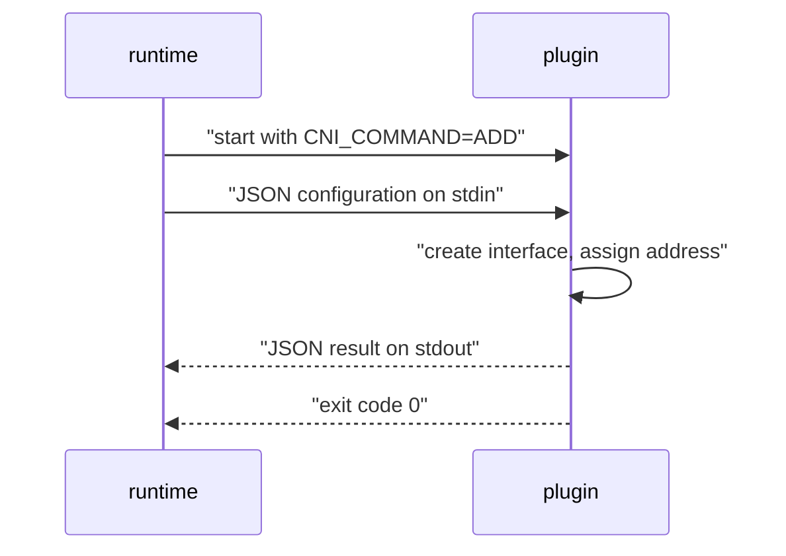

# The CNI Operations And Their Result

A CNI plugin is a plain executable file. It has no server, no port and no state in the Kubernetes API. The container runtime starts it, tells it what to do, reads its answer and lets it exit. This part explains the contract of that single call: what the runtime sets, what the plugin reads, what it returns and how the flannel plugin turns the call into a bridge, an address and a route.

## The operations

The CNI specification defines the operation as the value of the environment variable `CNI_COMMAND`. The runtime starts the plugin once per operation.

- `ADD` connects a container to the network. The plugin creates the interface in the network namespace of the pod, assigns an address and returns the result.
- `DEL` removes the container from the network. The runtime calls it when the sandbox stops. The plugin releases the address and removes what `ADD` created.
- `CHECK` asks the plugin to confirm that the container is still connected as `ADD` reported. The plugin exits with a non-zero code if it is not.
- `VERSION` asks which versions of the specification the plugin supports. It needs no network namespace.

Newer versions of the specification add `STATUS` and `GC`. `STATUS` asks whether the plugin can serve `ADD` calls now. `GC` asks the plugin to clean up resources that belong to containers that no longer exist. The two operations are optional for a runtime to call, and the rest of this part uses `ADD` and `DEL`.

## What the runtime sends

The runtime passes the details of the call in environment variables and the configuration on standard input. Standard input (stdin) is the stream a program reads data from.

| Environment variable | Meaning |
| --- | --- |
| `CNI_COMMAND` | The operation: `ADD`, `DEL`, `CHECK` or `VERSION` |
| `CNI_CONTAINERID` | The identifier the runtime gave the sandbox |
| `CNI_NETNS` | The path of the network namespace of the pod |
| `CNI_IFNAME` | The name of the interface to create inside the pod, normally `eth0` |
| `CNI_ARGS` | Extra key and value pairs, for example the pod name and namespace |
| `CNI_PATH` | The directories the plugin searches for other plugins |

The standard input holds the JSON configuration of this plugin: the entry from the configuration file, with `cniVersion` and `name` copied from the top of the file. In a chain, it also holds `prevResult` for every plugin after the first one. The plugin may not rely on files or on the order of earlier calls, because each call is a new process.



The diagram shows one call. The runtime provides all input at the start, the plugin works, and the plugin answers on standard output (stdout) and with its exit code.

## What the plugin returns

On success the plugin prints a JSON object and exits with code 0. The fields of a result are listed below.

- `cniVersion`: the specification version of the result.
- `interfaces`: the interfaces the plugin created. Each has a `name`, a `mac` address and a `sandbox` field that holds the namespace path for an interface inside the pod.
- `ips`: the addresses. Each has an `address` in CIDR form (an address with its prefix length), a `gateway` and an `interface` field that is an index into the list `interfaces`.
- `routes`: the routes the pod needs. Each has a destination `dst` and a gateway `gw`.
- `dns`: optional name servers, search domains and options.

The next block shows the shape of a result. The values are an example to show the fields, not output captured from your cluster.

```json
{
  "cniVersion": "1.0.0",
  "interfaces": [
    { "name": "eth0", "mac": "0a:58:0a:f4:01:05", "sandbox": "/var/run/netns/cni-example" }
  ],
  "ips": [
    { "address": "10.244.1.5/24", "gateway": "10.244.1.1", "interface": 0 }
  ],
  "routes": [
    { "dst": "0.0.0.0/0", "gw": "10.244.1.1" }
  ]
}
```

On failure the plugin exits with a non-zero code and prints an error object with `cniVersion`, `code`, `msg` and optional `details` fields. Codes 0 to 99 are reserved for well-known errors. For example, code 7 means the network configuration is invalid, and code 11 means the runtime should try again later. A runtime that gets an error from `ADD` fails the pod sandbox, and the kubelet retries.

## How flannel handles an `ADD`

The `flannel` binary is a small plugin that delegates. When it gets an `ADD`, it reads the file `/run/flannel/subnet.env` that the flannel pod on the same node writes. The file holds the network of the whole cluster and the range of this node. Print it from a node.

<!-- astrona:playground:renew -->
```sh
NODE="$(kubectl get nodes -o jsonpath='{.items[0].metadata.name}')"
kubectl debug node/"$NODE" -it --image=busybox:1.37 -- cat /host/run/flannel/subnet.env
```

The file has the variables `FLANNEL_NETWORK`, `FLANNEL_SUBNET`, `FLANNEL_MTU` and `FLANNEL_IPMASQ`. `FLANNEL_NETWORK` is the cluster-wide pod network, `10.244.0.0/16` in this cluster. `FLANNEL_SUBNET` is the range of the node, a `/24` taken from that network. The values for your node are in the output.

Flannel then builds a configuration for the `bridge` plugin. It sets the address manager to `host-local` with the range `FLANNEL_SUBNET`, merges the `delegate` settings from `cni-conf.json` and runs `bridge` with the same environment variables. The `bridge` plugin creates a Linux bridge, named `cni0` by default, creates a virtual Ethernet (veth) pair, moves one end into the pod namespace as `eth0` and attaches the other end to the bridge. A veth pair is two virtual interfaces connected like two ends of a cable: a packet that enters one end leaves at the other end. The `host-local` plugin picks the next free address from the node range and records it in a file on the node.

The flannel setting `isDefaultGateway: true` gives the pod a default route through the bridge address, and `hairpinMode: true` lets a pod reach itself through a Service address.

## Seeing the result in a pod

The pod address and route are what the result described. Read them inside the `shuttle` pod.

```sh
kubectl -n starfleet exec shuttle -- ip addr show eth0
kubectl -n starfleet exec shuttle -- ip route
```

The first command shows an `inet` address in the `FLANNEL_SUBNET` range of the node that runs the pod. The second shows a default route and a route for the node range, which match the fields `ips` and `routes` of the result. The pod IP also appears in the Kubernetes API, where the kubelet reports it from the runtime.

```sh
kubectl -n starfleet get pods -o wide
```

## The second plugin in the chain

After `flannel` returns, the runtime calls `portmap` with that result as `prevResult`. The `portmap` plugin reads the port mappings the runtime passed in the `portMappings` capability. It adds firewall rules only for pods that declare a `hostPort`. For all other pods, it returns the previous result unchanged. The runtime then reads the pod address from the final result and reports it to the kubelet.

When the pod stops, the runtime calls `DEL` in the reverse order: `portmap` first and `flannel` second. The `flannel` plugin passes `DEL` to `bridge`, and `host-local` frees the address.

You now know what a call carries and returns. The open question is where the configuration comes from in the first place, because a node with no configuration file has no network at all.

## Common pitfalls

> [!WARNING]
> A plugin must print only the JSON result on stdout. Any extra text breaks the runtime parser, so a plugin writes logs to stderr or to a file. A plugin must also handle `DEL` for a container that no longer exists without an error, because the runtime may call `DEL` more than once. Do not call a plugin binary by hand on a node unless the node is a disposable test node, because a manual `ADD` can leave an address allocated.
