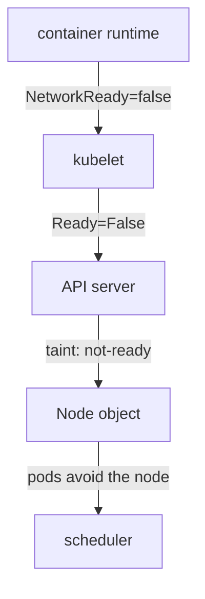

# Why Nodes Stay NotReady Without A Plugin

A Kubernetes cluster is useful only when pods can start, and a pod can only start when its sandbox has a network. On a fresh cluster with no network plugin, that is not possible. The cluster still answers `kubectl` commands, so it looks alive. This part shows the symptoms in the order you meet them, explains which component produces each one, and explains why some pods run even though no pod network exists.

## How a node learns that the network is missing

The kubelet reports the health of its node in the conditions of the Node object. The condition `Ready` is `True` when the node can run pods. The kubelet asks the container runtime for its status, and the runtime reports a field named `NetworkReady`. The runtime sets it to false while it has no valid CNI configuration in `/etc/cni/net.d`.

The kubelet then sets the condition `Ready` to `False` with the reason `KubeletNotReady`, and the message includes the text `cni plugin not initialized`. The message text can differ between runtime versions, but it always names the network plugin.



The diagram shows the chain. The runtime reports its state to the kubelet, the kubelet updates the Node object through the API server, a controller adds a taint, and the scheduler uses the taint.

## See the node state

Start with the nodes.

<!-- astrona:playground:renew -->
```sh
kubectl get nodes
```

Both nodes have the status `NotReady`. Now read the condition and its message for one node.

```sh
NODE="$(kubectl get nodes -o jsonpath='{.items[0].metadata.name}')"
kubectl get node "$NODE" -o jsonpath='{range .status.conditions[?(@.type=="Ready")]}{.status}{"  "}{.reason}{"  "}{.message}{"\n"}{end}'
```

The line shows `False`, the reason and the message of the runtime. The `kubectl describe node` command shows the same condition in the `Conditions` table and lists the taints of the node.

```sh
kubectl describe node "$NODE" | grep -A3 Taints
```

The node has the taint `node.kubernetes.io/not-ready`. The node lifecycle controller in the control plane adds this taint when `Ready` is not `True`. The effect is `NoSchedule`, so the scheduler does not place new pods on the node unless a pod tolerates it. The control-plane node has an additional taint, `node-role.kubernetes.io/control-plane`, that keeps ordinary pods away even when the node is healthy.

## Which pods still run

List all pods with their nodes.

```sh
kubectl get pods -A -o wide
```

The static pods of the control plane run: the API server, the controller manager, the scheduler and etcd. A static pod is a pod that the kubelet starts from a manifest file on the node, without the scheduler. These pods use `hostNetwork: true`, so they share the network namespace of the node and need no CNI plugin. The `kube-proxy` pods run as well. The kube-proxy DaemonSet also uses the node network, and its tolerations accept the taints.

The pods of CoreDNS stay `Pending`. They need a pod network and they do not tolerate the `not-ready` taint, so the scheduler cannot place them. This is why DNS does not work in a cluster without a network plugin, even though the Deployment exists.

## Test with an ordinary pod

Create a pod and read the reason for its state.

```sh
kubectl run net-test --image=curlimages/curl:8.22.0 --restart=Never --command -- sleep 3600
kubectl describe pod net-test | grep -A5 Events
```

The pod stays `Pending`. The event from the scheduler is a `FailedScheduling` message that says the nodes have untolerated taints. This is a scheduling failure and not a network failure, which is a useful difference: a pod with `Pending` status has not reached any node yet, and a pod with `ContainerCreating` status has reached a node and is waiting for the runtime.

Delete the test pod before the next step.

```sh
kubectl delete pod net-test
```

## Why tolerating the taint is not enough

A pod can tolerate the taint and then reach a node. If that pod does not use `hostNetwork`, the kubelet asks the runtime to create the sandbox. The runtime finds no CNI configuration and fails the call, so the pod stays in `ContainerCreating` with an event that names the network plugin. Only a pod that uses the node network can run in this state, and that is how a network plugin itself starts: its DaemonSet sets `hostNetwork: true` and tolerates the taints. The DaemonSet controller also adds tolerations for `node.kubernetes.io/not-ready` and `node.kubernetes.io/network-unavailable` to DaemonSet pods that use the node network.

## What the node still has

The node already has the plugin binaries. Read the binary directory and the configuration directory through a debug pod.

```sh
kubectl debug node/"$NODE" -it --image=busybox:1.37 -- ls /host/opt/cni/bin /host/etc/cni/net.d
```

The binary directory lists the reference plugins, including `bridge`, `host-local`, `loopback` and `portmap`. The configuration directory is empty. The binaries are present, but the runtime has nothing that tells it which plugin to run, so the network stays not ready. The fix is therefore a configuration file, plus the plugin binary that the file names.

You now know that the missing piece is a configuration file on every node and that only a pod on the node network can put it there. The open question is how to install such a pod and how to know that the installation worked.

## Common pitfalls

> [!WARNING]
> A `Pending` pod and a `ContainerCreating` pod have different causes: the first is not scheduled, the second has a runtime or network error. Do not delete the node to fix `NotReady`; the node is healthy and waits for a CNI configuration. Remove the `node-debugger` pods you create with `kubectl debug`, and delete the `net-test` pod.
