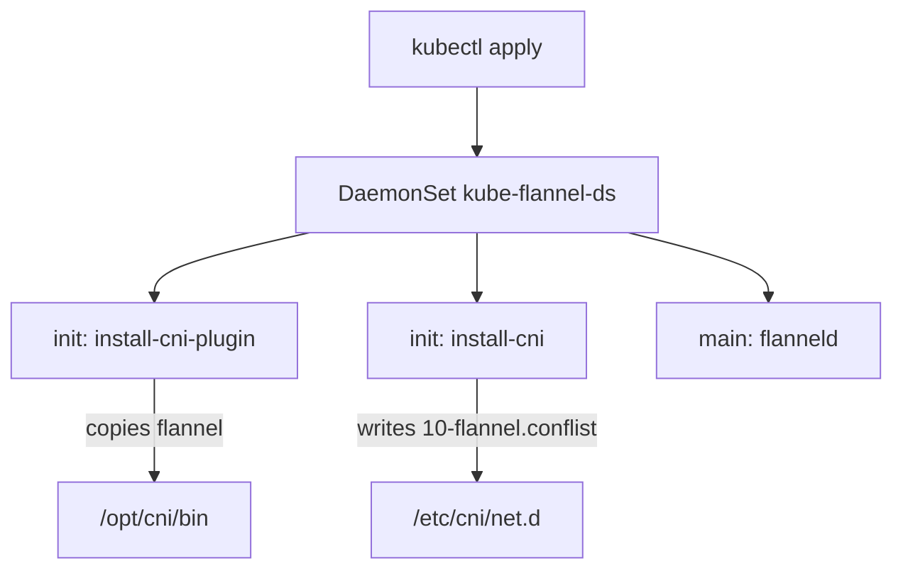

# Installing And Verifying Flannel

A node needs a CNI configuration file and a plugin binary, and only a pod on the node network can put them there. Flannel solves this with a DaemonSet that runs on every node and copies both files before it starts its main process. This part installs flannel from a pinned manifest, explains each object in it and then verifies the result at three levels: node status, pod addresses and traffic between nodes.

## What flannel does

Flannel is a network plugin that gives each node a range of pod addresses and connects the nodes with an overlay network. An overlay network is a virtual network built on top of the node network. Flannel's default backend is VXLAN (Virtual Extensible LAN). With VXLAN, the sending node wraps the pod packet in a UDP packet addressed to the node that runs the destination pod, and the receiving node unwraps it.

Flannel does not decide the ranges. The Kubernetes controller manager assigns each node a range and stores it in the field `spec.podCIDR` of the Node object. Flannel reads that field. It runs with the option `--kube-subnet-mgr`, which means it takes the node range from the Kubernetes API and not from a separate data store. The cluster must have the node ranges turned on, and the network in the flannel configuration must contain them. In this cluster the pod subnet is `10.244.0.0/16`, and flannel's `net-conf.json` has `"Network": "10.244.0.0/16"`.

## The objects in the manifest

The manifest of flannel v0.28.10 has these objects.

- A Namespace `kube-flannel` with the label `pod-security.kubernetes.io/enforce: privileged`, because the pods use host networking.
- A ServiceAccount `flannel`, a ClusterRole and a ClusterRoleBinding. The role lets flannel get pods, read nodes and patch `nodes/status`.
- A ConfigMap `kube-flannel-cfg` with the keys `cni-conf.json` and `net-conf.json`.
- A DaemonSet `kube-flannel-ds` that runs the pods.

The pod has two init containers and one main container. `install-cni-plugin` copies the `flannel` binary to `/opt/cni/bin/flannel`. `install-cni` copies `cni-conf.json` to `/etc/cni/net.d/10-flannel.conflist`. The main container runs `/opt/bin/flanneld --ip-masq --kube-subnet-mgr` with the capabilities `NET_ADMIN` and `NET_RAW`. The option `--ip-masq` makes flannel add a masquerade rule, which replaces the pod address with the node address on traffic that leaves the pod network.



The diagram shows the objects of one pod. The init containers prepare the two directories, and `flanneld` keeps running to maintain the network.

## Install flannel

The command below downloads the manifest from the flannel release and applies it. Use the pinned release and do not edit it.

<!-- astrona:playground:renew -->
```sh
kubectl apply -f https://github.com/flannel-io/flannel/releases/download/v0.28.10/kube-flannel.yml
```

The command prints one line for each object it creates. Wait for the DaemonSet to finish its rollout.

```sh
kubectl -n kube-flannel rollout status daemonset/kube-flannel-ds --timeout=300s
```

The command returns when a flannel pod is ready on each node. The pods run even though the nodes are `NotReady`, because the DaemonSet uses `hostNetwork: true` and tolerates the taints.

## What changes on the nodes

When `install-cni` writes the file, the runtime finds a valid CNI configuration and reports `NetworkReady=true`. The kubelet sets the condition `Ready` to `True`. Flannel also patches the status of its node to say that the network is available, which is why its role has the permission on `nodes/status`. The node lifecycle controller removes the `not-ready` taint. Check the nodes.

```sh
kubectl wait --for=condition=Ready nodes --all --timeout=180s
kubectl get nodes
```

Both nodes are `Ready` now. The scheduler can place pods again, and the CoreDNS pods, which waited in `Pending`, start. Wait for them.

```sh
kubectl -n kube-system rollout status deployment/coredns --timeout=300s
kubectl -n kube-system get pods -o wide -l k8s-app=kube-dns
```

The CoreDNS pods have addresses that start with `10.244.`. Each pod gets an address from the range of the node that runs it, so two pods on different nodes show different third numbers.

## Verify a pod address

The first level of verification is the node status. The second level is a new pod. Start a pod that the cluster has not seen before and read its address.

```sh
kubectl run web-worker --image=ghcr.io/stefanprodan/podinfo:6.15.0
kubectl wait --for=condition=Ready pod/web-worker --timeout=120s
kubectl get pod web-worker -o wide
```

The pod runs on the worker node, because the control-plane node keeps its own taint. Its address is in `10.244.0.0/16` and inside the range of the worker node. You can compare it with the node range.

```sh
kubectl get nodes -o custom-columns=NAME:.metadata.name,PODCIDR:.spec.podCIDR
```

## Verify traffic between nodes

The third level is traffic across nodes, because an overlay that fails often passes the first two levels. A pod can run on the control-plane node without a toleration if you set `nodeName` in its specification, because `nodeName` skips the scheduler and the taint only affects the scheduler. Save this as `pod-client-cp.yaml` and replace `<CONTROL_PLANE>` with the name of the control-plane node (`kubectl get nodes` shows it):

```yaml
apiVersion: v1
kind: Pod
metadata:
  name: client-cp
spec:
  nodeName: <CONTROL_PLANE>
  containers:
  - name: client
    image: curlimages/curl:8.22.0
    command: ["sleep", "3600"]
```

Apply it:

```sh
kubectl apply -f pod-client-cp.yaml
kubectl wait --for=condition=Ready pod/client-cp --timeout=120s
```

Then send a request from `client-cp` on the control-plane node to `web-worker` on the worker node:

```sh
WORKER_POD_IP="$(kubectl get pod web-worker -o jsonpath='{.status.podIP}')"
kubectl exec client-cp -- curl -s -m 5 -o /dev/null -w '%{http_code}\n' http://"$WORKER_POD_IP":9898/healthz
```

The command prints `200`. The packet left the pod, reached the `cni0` bridge, went through the VXLAN interface `flannel.1` and crossed the node network to the other node, where the same steps ran in reverse. If the node network blocks UDP port 8472, the request fails and the command prints `000`, even though the nodes are `Ready`.

Remove the test pods when you finish.

```sh
kubectl delete pod web-worker client-cp
```

You have now installed a network plugin and checked it at three levels. The nodes are `Ready` because a configuration exists, pods get addresses because the plugin assigns them from the node range, and pods on different nodes reach each other because the overlay carries the traffic.

## Common pitfalls

> [!WARNING]
> Do not edit the manifest to change the pod network without changing the pod subnet of the cluster: flannel and the controller manager must agree, otherwise pods get addresses that flannel does not route. Apply only one network plugin: two configuration files in `/etc/cni/net.d` leave the node with the file that sorts first. A `Ready` node does not prove that pods reach each other, so always test a request across nodes. Replace the placeholder `<CONTROL_PLANE>` in the file before you apply it, because the API server rejects the node name `<CONTROL_PLANE>`.
