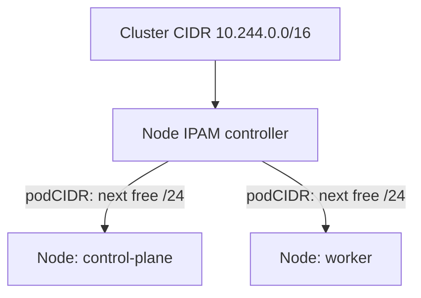

# The Cluster CIDR And Node Ranges

A cluster with many nodes needs a way to give out pod addresses without two nodes choosing the same address. Asking a central server for every pod would be slow and would break when that server is down. Kubernetes avoids this by cutting one large address range into small ranges, one for each node. This part explains how the cut is made, which component makes it and which flags control it.

## CIDR blocks

An IP address range is written in Classless Inter-Domain Routing (CIDR) notation: an address, a slash and a prefix length. The prefix length says how many of the first bits are fixed. In `10.244.0.0/16` the first 16 bits are fixed, so the block holds every address from `10.244.0.0` to `10.244.255.255`. That is 65,536 addresses. In `10.244.1.0/24` the first 24 bits are fixed, so only the last number changes. That block holds 256 addresses, from `10.244.1.0` to `10.244.1.255`.

Two addresses in an IPv4 block have a special use. The first address is the network address, and the last address is the broadcast address. A `/24` block therefore holds 254 addresses for hosts. The IPAM plugin that the course covers later uses the first host address of the block, for example `10.244.1.1`, as the address of the gateway on the node.

## The cluster CIDR

The cluster CIDR is the single large block from which all pod ranges are cut. In the playground it is `10.244.0.0/16`. A cluster administrator chooses it when the cluster is created. The block must not overlap with the node network, the Service network or any network that pods need to reach outside the cluster.

The kubeadm tool, which creates most clusters, writes this value as `networking.podSubnet` in its `ClusterConfiguration`. It stores that configuration in the ConfigMap `kubeadm-config` in the `kube-system` namespace. kind uses kubeadm, and the kind cluster configuration field `podSubnet` fills the same value.

## The node IPAM controller

The kube-controller-manager is a control plane program that runs many controllers in one process. One of them is the node IPAM controller. When a new Node object appears and has no pod range, the controller takes the next free block of the cluster CIDR and writes it into the Node object. The field is `spec.podCIDR`. For a cluster with two address families the plural field `spec.podCIDRs` holds one block for each family.



The diagram shows that the controller is the only component that cuts the cluster CIDR. A node does not choose its own range, and neither does the network plugin. The plugin only reads the result.

Three flags of the kube-controller-manager control this work:

- `--allocate-node-cidrs` turns the allocation on. Without it the controller does not write `spec.podCIDR`.
- `--cluster-cidr` is the block to cut from.
- `--node-cidr-mask-size` is the prefix length of each node block. For IPv4 the default is 24.

With a cluster CIDR of `/16` and a node mask of `/24`, the controller can create 256 node ranges. A `/24` node block has 254 usable addresses, which is more than the kubelet default limit of 110 pods on a node. The spare addresses let the plugin reuse addresses slowly after pods stop.

## See it on the playground

<!-- astrona:playground:renew -->

List the nodes with the range that each one received. The `custom-columns` output format prints chosen fields of each object:

```sh
kubectl get nodes -o custom-columns=NAME:.metadata.name,POD_CIDR:.spec.podCIDR
```

The output has one line for each node, and each line has a different `/24` block that starts with `10.244.`. The blocks do not overlap. Run the same command with `-o yaml` on one node and find `podCIDR` and `podCIDRs` under `spec`.

Next, read the cluster configuration that kubeadm stored. The jsonpath expression below selects the `ClusterConfiguration` text, and `grep` keeps the line with the pod network:

```sh
kubectl -n kube-system get configmap kubeadm-config -o jsonpath='{.data.ClusterConfiguration}' | grep podSubnet
```

The line shows the same `10.244.0.0/16` block. Finally, look at the arguments of the controller manager. It runs as a static pod on the control plane node:

```sh
kubectl -n kube-system get pods -l component=kube-controller-manager -o jsonpath='{.items[0].spec.containers[0].command}'
```

The command list contains `--allocate-node-cidrs=true` and `--cluster-cidr=10.244.0.0/16`. It shows that the controller manager, and not flannel, cuts the ranges.

## A range belongs to a node

The controller writes `spec.podCIDR` once, when the Node object is new. It does not change the field of an existing node, and the API server rejects an edit of the field. Changing the cluster CIDR of a running cluster is therefore not a small change: the nodes must be created again so that the controller cuts new ranges.

## Three address spaces

A cluster uses three separate address ranges, and a mistake in one of them is a common cause of broken networking.

- The node network holds the addresses of the machines. The cloud, the router or the container engine assigns them.
- The pod network is the cluster CIDR, cut into node ranges as described above.
- The Service network holds the virtual addresses of Services. It is set with the flag `--service-cluster-ip-range` of the API server and has no relation to node ranges.

The three ranges must not overlap. If a pod range overlapped the node network, a pod could not tell a packet for a node from a packet for a pod, and the routes would send traffic to the wrong place.

## A worked calculation

Take the cluster CIDR `10.244.0.0/16` and the node mask `/24`. The controller cuts the block into `/24` ranges in order: `10.244.0.0/24`, `10.244.1.0/24`, `10.244.2.0/24` and so on up to `10.244.255.0/24`. The number of ranges is 2 to the power of (24 minus 16), which is 256. A cluster with this setting cannot have more than 256 nodes that need a range, because the controller has no block left for the 257th node.

If you need more nodes, you choose a larger cluster CIDR such as `/12`, or a longer node mask such as `/25`, which gives each node 126 host addresses. The right values depend on the number of nodes and on the largest number of pods on one node.

This part showed that the cluster CIDR is cut into node ranges by the node IPAM controller, and that kubeadm, kind and the controller manager flags all name the same block. The open question is how a network plugin on a node learns which block it received, and how you can match a pod address to a range.

## Common pitfalls

> [!WARNING]
> If `spec.podCIDR` is empty on a node, the controller manager was started without `--allocate-node-cidrs`, or the cluster uses a plugin that keeps its own ranges. Do not set the field by hand on a running node, because the field cannot be changed after it is set. A node mask that is too large, for example `/28`, leaves only 14 addresses for pods on that node.
