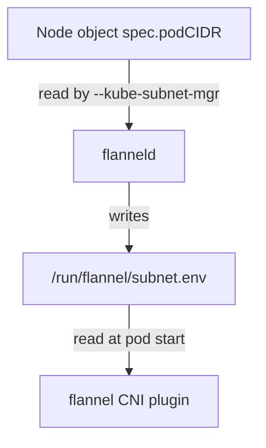

# Reading Ranges In Kubernetes Objects

When a pod cannot reach another pod, one of the first questions is: which node runs each pod, and does each pod address belong to the range of its node? The answer needs three objects: the Node, the Pod and the configuration of the network plugin. This part shows where each fact is stored, how to read it with `kubectl`, and how flannel uses the range that the controller wrote.

## What the Node object holds

The Node object has the range in `spec.podCIDR`. It has the address of the machine in `status.addresses`, where the entry of type `InternalIP` is the address that other nodes use to reach this node. The two values belong to different networks and must not be mixed up. A pod on the node receives an address from the pod range, and the node itself keeps its machine address.

Print both values for each node. The `-o wide` flag adds the internal address, and the custom columns add the range:

```sh
kubectl get nodes -o wide
kubectl get nodes -o custom-columns=NAME:.metadata.name,INTERNAL_IP:.status.addresses[0].address,POD_CIDR:.spec.podCIDR
```

The first command shows the internal address in its own column. The second shows both values next to each other. The pod range never contains the internal address of any node.

## What the Pod object holds

The Pod object records the node in `spec.nodeName` after the scheduler has chosen one. The pod address is in `status.podIP`. When a pod has addresses of several families, `status.podIPs` lists all of them and `status.podIP` repeats the first. The CNI plugin returns the address to the container runtime, and the kubelet writes it into the status of the pod.

The `-o wide` output of `kubectl get pods` shows the address and the node. Run it across all namespaces:

<!-- astrona:playground:renew -->

```sh
kubectl get pods -A -o wide
```

Each pod of `starfleet` and `outpost` shows an address that starts with `10.244.` and a node name. Compare the third number of the address with the range of its node. A pod on the node whose range is `10.244.1.0/24` has an address that starts with `10.244.1.`. If a pod does not match, the plugin allocated the address from a wrong source, and that is a real fault.

Some pods do not follow this rule. A pod with `hostNetwork: true` shares the network namespace of the node and has the address of the node, not an address from the range. In the playground these are the flannel pods, the kube-proxy pods and the control plane pods. Select only the pods that use a pod address with this check:

```sh
kubectl get pods -A -o custom-columns=NS:.metadata.namespace,NAME:.metadata.name,HOSTNET:.spec.hostNetwork,IP:.status.podIP
```

The column `HOSTNET` shows `true` for the pods that use the node address, and `<none>` for the others.

## How flannel learns the range

flannel runs as a DaemonSet, so one flannel pod runs on every node. The pod starts the program `flanneld` with the argument `--kube-subnet-mgr`. This argument tells flannel to take its subnet from the Kubernetes API, and not from a separate store. The program reads the Node object of its own node and uses `spec.podCIDR` as its range.

flannel then writes the file `/run/flannel/subnet.env` on the node. The file holds four variables:

- `FLANNEL_NETWORK` is the cluster-wide pod network, here `10.244.0.0/16`.
- `FLANNEL_SUBNET` is the range of this node with the gateway address, for example `10.244.1.1/24`.
- `FLANNEL_MTU` is the largest packet size that pods on this network should use.
- `FLANNEL_IPMASQ` says whether traffic that leaves the pod network is masqueraded, which means its source address is rewritten to the node address.

The CNI plugin of flannel reads this file when a pod starts, and it builds the address allocation from the subnet.



The diagram shows a one-way flow: the controller writes the range, flanneld copies it into a file and the CNI plugin reads the file. Nothing in this chain lets the plugin choose its own range.

You can read the file from a debug pod that mounts the node file system under `/host`. Replace `<node>` with a node name from `kubectl get nodes`:

```sh
kubectl debug node/<node> -it --image=busybox:1.37.0 -- cat /host/run/flannel/subnet.env
```

The `FLANNEL_SUBNET` value matches the `spec.podCIDR` of that node. The command creates a debug pod in the `default` namespace. Delete the debug pod when you have finished.

## The flannel configuration

The cluster-wide network of flannel is in the ConfigMap `kube-flannel-cfg` in the namespace `kube-flannel`, under the key `net-conf.json`. The field `Network` there must equal the cluster CIDR of the controller manager. Read it:

```sh
kubectl -n kube-flannel get configmap kube-flannel-cfg -o jsonpath='{.data.net-conf\.json}'
```

The output is a short JSON document with `Network` and a `Backend` block. If `Network` and `--cluster-cidr` differ, pods get addresses from node ranges that flannel does not route, and traffic between nodes fails.

You now know where to find the three facts that every address problem starts with: the range of a node, the node of a pod and the network that flannel routes. The open question is how a single address is chosen inside a node range, and that choice is made by the IPAM plugin of the node, not by Kubernetes.

## Common pitfalls

> [!WARNING]
> Do not compare a pod address with the internal address of a node: they belong to different networks. A `hostNetwork` pod always shows the node address, so it is not a fault when such a pod is outside the range. When the first three numbers of a pod address do not match the range, check that the `--cluster-cidr` flag and the flannel `Network` field name the same block.
