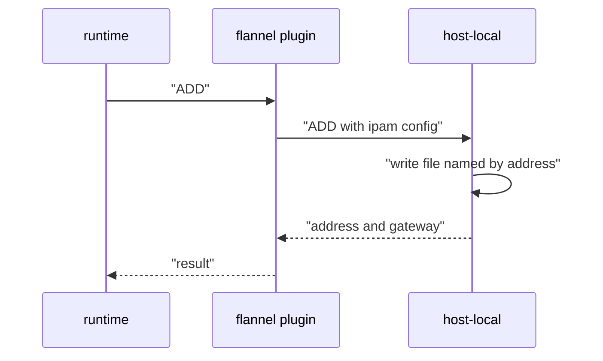

# The host-local IPAM Plugin

When the container runtime starts a pod, the main CNI plugin must give the pod an address. Most plugins do not write their own address bookkeeping. They call a second plugin, an IPAM plugin, and ask it for an address. This part explains the role of the IPAM plugin, the configuration of `host-local`, the files it writes on the node and the way flannel uses it.

## What an IPAM plugin does

An IPAM plugin is a CNI plugin that only manages addresses. It does not create interfaces and it does not touch the network namespace of the pod. The main plugin runs it with the same environment variables as the main call, for example `CNI_COMMAND=ADD`, and passes the same JSON configuration on standard input. The IPAM plugin returns a JSON result with the address, the prefix length, the gateway and the routes. The main plugin then configures the interface with these values. When the pod stops, the main plugin calls the IPAM plugin with `DEL`, and the address becomes free again.

The standard plugin is `host-local`, and it is part of the reference plugins that the CNI project publishes. The name says what it does: it keeps its state on the local host, in files, and it needs no network service. Because every node has its own range, two nodes cannot hand out the same address, and no coordination between nodes is needed.

## The configuration

The `ipam` object inside the CNI configuration selects the plugin and its settings. A typical object looks like this:

```json
{
  "ipam": {
    "type": "host-local",
    "ranges": [
      [ { "subnet": "10.244.1.0/24" } ]
    ],
    "routes": [ { "dst": "0.0.0.0/0" } ]
  }
}
```

The field `ranges` is a list of lists. Each inner list is a set of ranges from one address family, and the plugin allocates one address from each inner list. Each range object can have these fields:

- `subnet` is the block, for example `10.244.1.0/24`. It is the only required field.
- `rangeStart` and `rangeEnd` limit the addresses that may be used inside the subnet.
- `gateway` is the gateway address. If it is not set, the plugin uses the `.1` address of the subnet.

If `rangeStart` is not set, the plugin starts at the `.2` address of the subnet, so `10.244.1.2` is the first pod address in this example, and `rangeEnd` defaults to the `.254` address. The network address `10.244.1.0` and the broadcast address `10.244.1.255` are never used. The older field `subnet` at the top of the `ipam` object is a short form of one range.

## The files of host-local

`host-local` keeps one directory for each network name, under `/var/lib/cni/networks` by default. The field `dataDir` can change the base directory. The network name comes from the `name` field of the CNI configuration. In the flannel configuration that name is `cbr0`, so the files are in `/var/lib/cni/networks/cbr0`.

For every allocated address the plugin creates a file that is named after the address, for example `10.244.1.5`. The file content is the identifier of the container that owns the address. A second file, `last_reserved_ip.0`, holds the last address that the plugin handed out. The plugin searches for the next free address starting after that value, so addresses are not reused immediately after a pod stops. A lock file in the same directory keeps two parallel calls from taking the same address.



The diagram shows that the runtime talks only to the main plugin. The main plugin calls `host-local`, the IPAM plugin writes a file, and the address goes back up the chain.

## How flannel calls host-local

The flannel CNI plugin is a thin plugin that delegates the work. It reads `/run/flannel/subnet.env` to learn the node range, builds the configuration of a delegate plugin and runs the delegate. By default the delegate is the `bridge` plugin, which receives the `ipam` object with `type: host-local` and the subnet of the node. The `delegate` block in the flannel CNI configuration, with `hairpinMode` and `isDefaultGateway`, adds settings to this generated configuration.

The bridge plugin creates a Linux bridge named `cni0` on the node, gives the bridge the first address of the node range as gateway, and connects every pod to the bridge with a virtual Ethernet pair.

## See it on the playground

<!-- astrona:playground:renew -->

Read the CNI configuration that flannel installs. The ConfigMap holds the same text that the init container copies to `/etc/cni/net.d/10-flannel.conflist`:

```sh
kubectl -n kube-flannel get configmap kube-flannel-cfg -o 'jsonpath={.data.cni-conf\.json}'
```

The text has no `ipam` object. That is correct: flannel builds it at run time from `subnet.env`. Next, list the four `crew` pods with their nodes and addresses:

```sh
kubectl -n starfleet get pods -l app=crew -o wide
```

Each address lies inside the range of the node in its row, and no two pods have the same address. To look at the files, start a debug pod on one node and list the directory. Replace `<node>` with a node name:

```sh
kubectl debug node/<node> -it --image=busybox:1.37.0 -- ls /host/var/lib/cni/networks/cbr0
```

The directory has one file for each pod address on that node, the file `last_reserved_ip.0` and a lock file. The files exist only for pods that use the pod network. Remember to delete the debug pod afterwards.

You now know that `host-local` allocates addresses from a node range and keeps its state in plain files, one for each address. The open question is what happens when the range is full or when ranges overlap. The rest of the module covers that.

## Common pitfalls

> [!WARNING]
> Do not delete files in `/var/lib/cni/networks` while pods still run. The plugin would then hand the same address to a second pod, and two pods would answer for one address. Files of pods that no longer exist, called stale files, are only removed when the runtime calls `DEL`. A crashed node can leave them behind.
