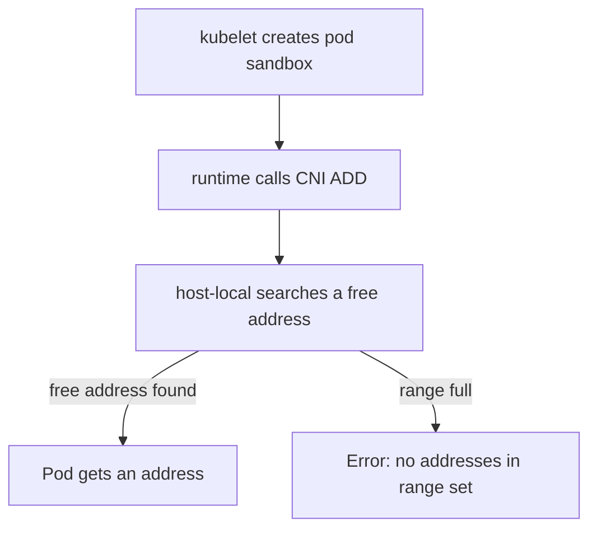

# Capacity, Exhaustion And Overlap

An address range is a fixed resource. If a node uses all addresses of its range, the next pod cannot start. If two ranges overlap, packets go to the wrong place and the symptoms look random. This part shows how to calculate the capacity of a node range, what an exhausted range looks like, and which overlaps cause trouble.

## Capacity of a node range

Count the usable addresses of a range from its prefix length. A `/24` block has 256 addresses. The network address and the broadcast address are not usable, so 254 remain. The `bridge` plugin takes one more address as the gateway of the node. That leaves 253 addresses for pods. With the `host-local` defaults, which start at `.2` and end at `.254`, the plugin offers 253 addresses.

The kubelet has its own limit. The setting `maxPods` of the kubelet defaults to 110 pods on one node. The scheduler does not place more pods than that on a node. A `/24` range is therefore larger than the kubelet limit, and the extra addresses give room for pods that are stopping and still hold an address.

The calculation changes with the node mask:

- A `/24` mask gives 253 pod addresses with the defaults.
- A `/25` mask gives about 125 pod addresses. That is still above 110 but leaves little room.
- A `/26` mask gives about 61 pod addresses, which is below the default kubelet limit. The range is exhausted before the kubelet stops the scheduler.

The pod count that matters is the number of pods that exist on the node, including pods that are finished but not yet deleted, such as `Completed` pods of Jobs. A pod in the phase `Succeeded` or `Failed` can keep its address until the sandbox is removed.

## What exhaustion looks like

When `host-local` has no free address it returns an error to the main plugin. The main plugin returns the error to the runtime, and the kubelet cannot create the pod sandbox. The pod stays in the status `ContainerCreating`. The events of the pod show a warning with the reason `FailedCreatePodSandBox`. The message ends with text from the plugin that says that no IP addresses are available in the range set.

Other nodes are not affected, because they have their own ranges. This is a useful clue: if pods fail on one node and start on another node, suspect the range of the first node. The pods that already run keep working.



The diagram shows that the failure happens inside the IPAM step, before the pod has an interface. The pod therefore never reaches the state where it could fail a readiness probe.

## Look at the numbers on the playground

<!-- astrona:playground:renew -->

Count the pods that hold an address from the range of each node. The command lists all pods with their nodes and addresses. The column `HOSTNET` helps you to leave out the pods that use the node address:

```sh
kubectl get pods -A -o custom-columns=NODE:.spec.nodeName,HOSTNET:.spec.hostNetwork,IP:.status.podIP
```

Count the rows of one node where `HOSTNET` is `<none>`. That number is far below 253, so the range of the node has plenty of room. Compare it with the kubelet limit. The following command prints the `maxPods` capacity that each node reports:

```sh
kubectl get nodes -o custom-columns=NAME:.metadata.name,MAX_PODS:.status.capacity.pods
```

Both nodes report the number of pods that the scheduler may place. The number is a limit of the kubelet and it is independent of the range, so you must keep the two in step yourself.

## Overlapping ranges

Overlap is the other range fault. The ranges that must stay apart are the pod range of each node, the node network, the Service network and any network behind the cluster, such as a company network that pods must reach.

- If a node range overlaps the node network, a packet to a node address can be routed as a packet to a pod.
- If the pod network overlaps the Service network, the address of a Service can also be the address of a pod, and the rules of kube-proxy take the packet first.
- If the pod network overlaps an external network, pods cannot reach hosts in that network, because the node routing table sends those packets back into the pod network.

The Service network is not part of any node range. It is set on the API server with `--service-cluster-ip-range`. You can read the address range of the Service `kubernetes` in the namespace `default`, which comes from that range:

```sh
kubectl -n default get service kubernetes -o jsonpath='{.spec.clusterIP}'
```

The address belongs to the Service network and must be outside `10.244.0.0/16`. In the playground it starts with `10.96.`.

## Changing a range

The node IPAM controller does not rewrite `spec.podCIDR` of a node that has one. Changing the cluster CIDR on a live cluster therefore needs new nodes. The usual procedure is to add nodes with the new setting, drain the old nodes and remove them. The old pods get new addresses when they start on the new nodes.

You can now calculate how many pods a range can hold, recognise exhaustion by its events and name the overlaps that cause trouble. The pod address work is complete: the cluster cuts ranges, and the IPAM plugin hands out single addresses from them.


## A worked calculation

Take a node with the range `10.244.1.0/24`. The block holds 256 addresses. Remove the network address `10.244.1.0` and the broadcast address `10.244.1.255`, and 254 remain. The gateway `10.244.1.1` belongs to the node, so 253 addresses are left for pods.

Now assume that 100 pods run on the node and 20 finished Job pods have not been removed yet. The plugin has 120 addresses in use and 133 free. If a cluster runs many short Jobs on one node and the finished pods are kept, the number of stored addresses can grow beyond the number of running pods, so clean up finished pods and set a `ttlSecondsAfterFinished` value on Jobs.

## Common pitfalls

> [!WARNING]
> Do not widen a range by editing files on the node. The plugin reads its range from `subnet.env`, and the controller manager owns `spec.podCIDR`, so a manual change creates a node that disagrees with the cluster. When pods stay in `ContainerCreating`, read the events with `kubectl describe pod` before you change anything, because several different faults give the same status.
