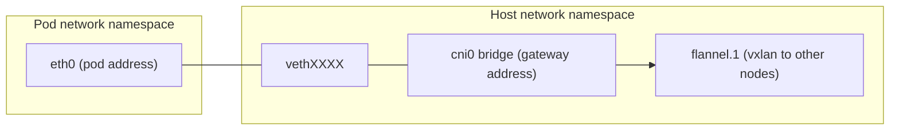

# The Network Namespace Of A Pod

A pod does not see the network of its node. It sees its own copy of the network stack. The Linux kernel provides this with network namespaces. This part explains what a network namespace holds, how the container runtime and the CNI plugin build one for a pod, and how you enter it to run `ip`.

## What a network namespace holds

A network namespace is an isolated set of network resources inside one kernel. Each namespace has its own:

- network interfaces, such as `lo` and `eth0`,
- IP addresses on those interfaces,
- routing tables,
- neighbour (ARP) tables,
- firewall rules for iptables and nftables,
- port numbers, so two namespaces can both listen on port 80.

A process that runs in a namespace sees only these resources. The node has a namespace of its own, called the host namespace or the root namespace. All containers of one pod share one namespace, so they share the pod address and they reach each other on `127.0.0.1`.

## How a pod gets its namespace

The sequence below happens each time the kubelet starts a pod. It matches the CNI contract: the runtime creates the namespace and the plugin fills it.

1. The kubelet asks the container runtime to create the pod sandbox.
2. The runtime creates a new network namespace for the sandbox. The sandbox container, also called the pause container, holds the namespace open.
3. The runtime calls the CNI plugin with the command `ADD`, the namespace path and the interface name `eth0`.
4. The plugin creates the interface and the address, and sets the routes inside the namespace.
5. The runtime starts the containers of the pod in the same namespace.

When the pod is deleted, the runtime calls the plugin with `DEL`, and the namespace is removed.

## The veth pair

An interface in the pod namespace must be connected to something outside it. The usual tool is a veth pair. A veth pair is two virtual interfaces that are linked like the two ends of a cable: a packet sent into one end comes out of the other end.

The plugin puts one end in the pod namespace and names it `eth0`. It leaves the other end in the host namespace, where it gets a name such as `veth` followed by random characters. With the `bridge` plugin, which flannel uses, the host end is attached to a Linux bridge, normally named `cni0`. The bridge connects all pods of a node and carries the gateway address of the node range.



Each veth end knows its peer by an interface index. The output of `ip link` in the pod shows the index of the peer after the name, in the form `eth0@if` and a number. The host interface with that index is the other end of the cable. This is the fastest way to match a pod to its host interface.

## Entering the namespace of a pod

You have three ways to run `ip` in the namespace of a pod. Which one works depends on what the container image contains.

The first way is `kubectl exec`. It runs a command inside a container of the pod. It works when the image has an `ip` binary. The client image in the playground has the busybox tools, which include a small `ip`.

<!-- astrona:playground:renew -->

```sh
kubectl -n starfleet exec shuttle -- ip addr show
```

The second way is an ephemeral debug container. It adds a new container with a tool image to the running pod. The new container shares the network namespace of the pod, so `ip` shows the same interfaces. This works for images that have no shell, such as the image of the `probe` pod:

```sh
kubectl -n starfleet debug -it pod/<probe-pod-name> --image=busybox:1.37.0 --target=probe -- sh
```

Replace `<probe-pod-name>` with the name from `kubectl -n starfleet get pods`. The option `--target` names the container whose process namespaces the debug container should join.

The third way is a debug pod on the node. `kubectl debug node/<node>` starts a pod in the host namespace of the node and mounts the root file system of the node under `/host`. From there you see the host side of every veth pair, the bridge and the routes of the node:

```sh
kubectl debug node/<node-name> -it --image=busybox:1.37.0 -- ip addr show
```

Here `ip` runs in the host namespace, because the debug pod uses the host network. Use `kubectl get nodes` to find the node name.

## Which namespace am I in

The same command gives different results depending on where it runs. Run `ip -4 addr show` in the `shuttle` pod and on a node and compare. In the pod you see `lo` and `eth0` with the pod address. On the node you see many more interfaces: the node interface, the bridge, the flannel interface and one veth for each pod.

If the result looks wrong, first check where you are. A common mistake is to run `ip route` on a node and read the output as if it described the pod.

## Common pitfalls

> [!WARNING]
> A command that works in one image can be missing in another. Images without a shell or without `ip` fail with a message such as "executable file not found". Do not install tools into a production pod. Use an ephemeral debug container or a node debug pod instead, and remove it when you are done. Also remember that `kubectl debug node` gives a privileged view of the node, so use it only on clusters where you are allowed to.
