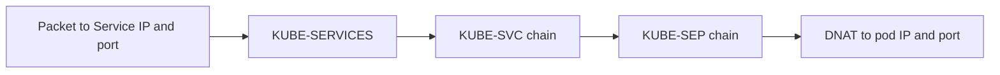

# iptables And The Service Rules

A Service address is virtual. No interface in the cluster has that address, so no process answers on it. A packet to a Service address works because the node rewrites its destination to the address of a real pod before the packet leaves. In a default cluster, kube-proxy creates the rules that do the rewriting, and it writes them with iptables. This part explains the structure of those rules and how to read them.

## Tables, chains and rules

iptables organises rules in tables, and each table has chains. A chain is an ordered list of rules. A rule has a match, such as a destination address and port, and a target, such as `ACCEPT`, `DROP`, `DNAT` or a jump to another chain.

The table that matters most for Services is `nat`. It changes addresses. It has built-in chains that the kernel calls at fixed points of the path of a packet:

- `PREROUTING` is called for packets that arrive from an interface, before the routing decision.
- `OUTPUT` is called for packets that a local process creates, before the routing decision.
- `POSTROUTING` is called after the routing decision, just before the packet leaves.

The `filter` table decides whether a packet is allowed. Its chains are `INPUT`, `FORWARD` and `OUTPUT`. kube-proxy also keeps a few rules there, for example to reject traffic to Services that have no endpoints.

## What kube-proxy creates for a Service

kube-proxy watches the Service and EndpointSlice objects through the API server and rewrites the rules on its node when they change. In iptables mode it creates three kinds of chains.

1. The chain `KUBE-SERVICES` has one rule for each Service port. It matches the cluster IP and the port, and jumps to a chain for that Service. The built-in chains `PREROUTING` and `OUTPUT` jump to `KUBE-SERVICES` first, so both pod traffic and local traffic are covered.
2. A chain named `KUBE-SVC-` followed by a hash exists for each Service port. It chooses one endpoint. With several endpoints, it has one rule per endpoint, and each rule uses the `statistic` match in random mode with a probability, so the traffic spreads out.
3. A chain named `KUBE-SEP-` followed by a hash exists for each endpoint. It performs the `DNAT` to the pod address and port. A rule in front of it marks traffic that comes from the pod itself, so the reply path works when a pod calls a Service that points back to itself.

The comments in the rules carry the namespace, name and port of the Service, such as `starfleet/probe`. The comment is the easiest way to find the right chain.



After the `DNAT`, the kernel makes the routing decision with the new destination. If the pod is on another node, the packet leaves through the flannel interface. The connection tracking table, conntrack, remembers the rewrite, so the reply packets are translated back without a rule.

## Reading the rules on a node

The rules live in the namespace of the node, not in the pod. Start a debug pod on the node with the profile for system administration. The default profile does not give enough privileges for iptables.

<!-- astrona:playground:renew -->

```sh
kubectl debug node/<node-name> -it --profile=sysadmin --image=busybox:1.37.0 -- chroot /host iptables-save -t nat
```

The root file system of the node is mounted under `/host`, and `chroot` makes the tools of the node available. The command prints the whole `nat` table in a format that you can search. Replace `<node-name>` with a name from `kubectl get nodes`. Pipe the result into `grep` on your own machine, or add the filter inside the debug pod, to keep only one Service:

```sh
kubectl debug node/<node-name> -it --profile=sysadmin --image=busybox:1.37.0 -- sh -c 'chroot /host iptables-save -t nat | grep starfleet/probe'
```

You should find a line in `KUBE-SERVICES` that names the cluster IP of the `probe` Service, a line in a `KUBE-SVC-` chain, and a line in a `KUBE-SEP-` chain that ends in a `DNAT` to the pod address. Compare the three addresses with `kubectl -n starfleet get service,endpointslices,pods -o wide`. They must agree. If the cluster IP in the rule differs from the Service, kube-proxy did not update the node.

Use `iptables -t nat -L KUBE-SERVICES -n -v` for a table view. The option `-n` prints numbers and does not resolve names, and `-v` adds the packet and byte counters.

## Counters

The counters show whether traffic hits a rule. Read the counter of the rule for the Service, send a request from `shuttle`, and read it again. If the counter grows, the packet reached the rule. If it does not grow, the packet never arrived on this node, or an earlier rule took it. The counters count since the rule was created or since the last reset, so compare two readings and do not read one value alone.

## Service rules and the node

Each node has the same Service rules, so a packet to a Service address is rewritten on the node where it is created. This is why a Service works from every pod, regardless of the node. It also means that a fault in kube-proxy on one node affects only the pods of that node.

## Masquerading

A second set of rules deals with source addresses. When a packet leaves the node toward a pod on another node, the receiving pod sees the source address of the packet. In a flannel cluster pod addresses are routable inside the cluster, so the source stays the pod address and no change is needed. For traffic that comes from outside the cluster, kube-proxy marks packets in the chain `KUBE-MARK-MASQ` and the chain `KUBE-POSTROUTING` rewrites their source to the address of the node. This makes the reply return through the same node. If a client outside the cluster sees an unexpected source address in the server log, this rule is the reason.

## Find out which proxy mode runs

The proxy mode is part of the kube-proxy configuration. In a kubeadm-style cluster, including kind, it is stored in a ConfigMap in `kube-system`. Read it before you look for chains:

```sh
kubectl -n kube-system get configmap kube-proxy -o yaml
```

Find the field `mode` in the embedded configuration. An empty value selects the default mode of the platform. The pods of kube-proxy are labelled `k8s-app=kube-proxy`, and one pod runs on each node. Their logs tell which proxier started.

## A checklist for a Service that does not answer

1. Does the Service have the right selector? Check `kubectl -n starfleet get endpointslices` for addresses.
2. Is kube-proxy running on the node of the client? Check its pod and its log.
3. Does the `nat` table on that node contain a rule for the cluster IP and port?
4. Does the rule chain end in a `DNAT` to a live pod address?
5. Does the counter of that rule grow when you send a request?
6. If the counter grows, capture packets to see whether the pod answers.

## Common pitfalls

> [!WARNING]
> Never flush or delete chains of kube-proxy by hand to fix a problem. A command such as `iptables -F` removes the rules that all Services on the node need, and the node loses Service traffic until kube-proxy restores the rules. Read the rules with `iptables-save` and fix the cause in the Service, the EndpointSlice or the kube-proxy configuration. Also note that some nodes use nftables instead of iptables for kube-proxy: check the kube-proxy mode in its configuration before you search for the chains.
