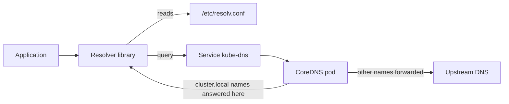

# How Pods Resolve Names

A pod that opens a connection to `probe` does not talk to CoreDNS by itself. The application calls a resolver library, the library reads a small file, and the file tells it which server to ask and which names to try. This part follows one lookup from start to finish, so that you know which step to test when a lookup fails.

## The resolver file of a pod

The kubelet creates `/etc/resolv.conf` in every pod that uses the default DNS policy. Print it from the client pod:

```sh
kubectl -n starfleet exec shuttle -- cat /etc/resolv.conf
```

The file has three kinds of lines:

- `nameserver` is the address of the DNS server. In a cluster it is the ClusterIP of the Service `kube-dns`, not a pod address.
- `search` is a list of domain suffixes. They are tried in order when a name is short.
- `options ndots:5` says how many dots a name needs before the resolver tries it as a complete name first.

The search list of a pod in the namespace `starfleet` starts with `starfleet.svc.cluster.local`, then `svc.cluster.local`, then `cluster.local`. The first entry holds the namespace of the pod, so the same short name means different Services in different namespaces.

## How a short name becomes a full name

The name `probe` has no dots, which is fewer than 5. The resolver therefore adds each search suffix in turn:

1. `probe.starfleet.svc.cluster.local`
2. `probe.svc.cluster.local`
3. `probe.cluster.local`
4. `probe` on its own

The first attempt succeeds for a Service in the same namespace. A pod in `outpost` that asks for `probe` tries `probe.outpost.svc.cluster.local`, which does not exist, and then the other names. It never finds `probe` in `starfleet`. The pod must ask for `probe.starfleet`. That name has one dot, still fewer than 5, so the resolver adds the suffix `svc.cluster.local` at the second attempt and finds the Service.

A name with a trailing dot, such as `probe.starfleet.svc.cluster.local.`, is complete. The resolver sends it as it is and does not add suffixes.

## The cost of ndots

With `ndots:5`, an external name such as `example.com` has one dot. The resolver tries `example.com.starfleet.svc.cluster.local` and the other suffixes first, and each attempt is a query that CoreDNS must answer with a negative result. A name that looks complete but has fewer than 5 dots therefore costs several queries. This is normal. It explains why logs show many failed lookups for names that finally work.

## The DNS server of the cluster

The address in `nameserver` belongs to a Service. Read it:

```sh
kubectl -n kube-system get service kube-dns
```

The Service is named `kube-dns` for historic reasons, but it selects the CoreDNS pods through the label `k8s-app=kube-dns`. Kube-proxy turns the ClusterIP into the address of one CoreDNS pod, so a request that goes to the ClusterIP is a request to one of the CoreDNS replicas. The pods are managed by the Deployment `coredns`:

```sh
kubectl -n kube-system get deployment coredns
kubectl -n kube-system get pods -l k8s-app=kube-dns -o wide
```

If the Service has no ready pods behind it, every lookup in the cluster fails. The EndpointSlice of the Service shows this:

```sh
kubectl -n kube-system get endpointslice -l kubernetes.io/service-name=kube-dns
```



The diagram shows the two places where a lookup can fail on the way. Either the query never reaches CoreDNS, or CoreDNS cannot answer it.

## The Corefile

CoreDNS reads its configuration from a Corefile. In a cluster the Corefile is stored in the ConfigMap `coredns` in `kube-system`, under the key `Corefile`, and mounted into the pods:

```sh
kubectl -n kube-system get configmap coredns -o jsonpath='{.data.Corefile}'
```

A typical Corefile has one server block for the root zone, `.:53`, and a list of plugins inside it. The ones that matter here are:

- `errors` writes errors to the log of the pod.
- `health` and `ready` open the endpoints that the kubelet uses for probes.
- `kubernetes cluster.local in-addr.arpa ip6.arpa` answers questions about Services and pods from the Kubernetes API. The first word after the plugin name is the zone that it serves.
- `forward . /etc/resolv.conf` sends every other question to the upstream servers listed in the resolver file of the node.
- `cache 30` keeps answers for up to 30 seconds.
- `loop` stops CoreDNS when it detects that it forwards to itself.
- `reload` makes CoreDNS check the Corefile for changes and load them.
- `loadbalance` shuffles the order of the address records in an answer.

The zone in the `kubernetes` line decides which names CoreDNS treats as cluster names. The zone `cluster.local` must match the cluster domain that the kubelet writes into the `search` line. If the two differ, a name such as `probe.starfleet.svc.cluster.local` is not answered from the API. It falls through to `forward` and the upstream server reports that the name does not exist.

## Which records exist

For a normal Service the `kubernetes` plugin answers with the ClusterIP. The name has the form `<service>.<namespace>.svc.<zone>`. For a headless Service, which has no ClusterIP, the answer is the list of the pod addresses behind it. Pods get records too, but a pod does not get a name from its own name. Nothing in the standard setup makes the pod name `shuttle` resolvable.

## Try it

<!-- astrona:playground:renew -->

Run these three commands in the playground and compare the results. The first and second use the same Service with two different names. The third asks for a name that does not exist.

```sh
kubectl -n starfleet exec shuttle -- curl -s -m 5 -o /dev/null -w '%{http_code}\n' http://probe:9898/
kubectl -n outpost exec drifter -- curl -s -m 5 -o /dev/null -w '%{http_code}\n' http://probe.starfleet:9898/
kubectl -n outpost exec drifter -- curl -s -m 5 -o /dev/null -w '%{http_code}\n' http://probe:9898/
```

The first two requests find the Service because the search suffix leads to `starfleet`. The third does not, because `drifter` searches in its own namespace. The status code `000` is what `curl` prints when it could not connect at all, including when the name did not resolve.

## Common pitfalls

> [!WARNING]
> Do not take a failed `curl` as proof that the network is broken. The code `000` has several causes, and an unresolved name is only one of them. Test the name and the address separately, before you change anything.
