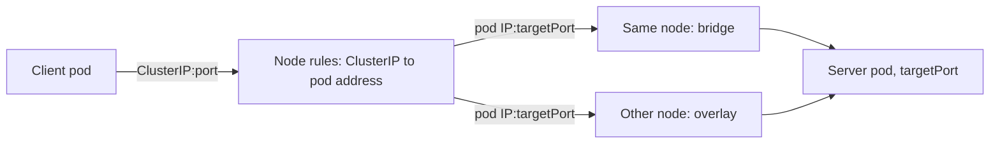

# How Service Traffic Reaches A Pod

A Service is a stable address in front of a changing set of pods. The address is virtual: no network interface owns it. Understanding what is real and what is virtual tells you where to look when a request fails. This part follows a request from the client pod to the server pod.

## The objects that describe a Service

Three kinds of objects are involved:

- The **Service** holds the ClusterIP, the port that clients use, the `targetPort` on the pods and the **selector**, which is a set of labels.
- The **EndpointSlice** objects hold the addresses of the pods that match the selector and are ready. The control plane creates and updates them. They carry the label `kubernetes.io/service-name` with the name of the Service.
- The **pods** carry the labels and run the containers that listen on a port.

Look at them for the Service `probe`:

```sh
kubectl -n starfleet get service probe -o yaml
kubectl -n starfleet get endpointslices -l kubernetes.io/service-name=probe -o yaml
kubectl -n starfleet get pods --show-labels -o wide
```

## How the selector fills the endpoints

The endpoint controller watches Services and pods. For each Service with a selector it lists the pods in the same namespace whose labels contain every key and value of the selector. A pod that matches and is ready becomes an endpoint with its pod address and its port. A pod that matches but is not ready is listed too, with the condition `ready: false`, and receives no traffic.

If no pod matches, the EndpointSlice has no endpoints and the Service has nothing to forward to. A typing error in the selector therefore does not cause an error message. The Service object looks normal, and the failure shows up only when a client sends a request.

## The port mapping

The Service has a `port`, which is the port that clients use on the ClusterIP. It also has a `targetPort`, which is the port on the pod. The two may differ. If `targetPort` is a number, traffic goes to that port of the pod. If it is a name, the name must match a `name` in `containerPort` of the pod. If the pod does not listen on that port, the pod answers the connection with a reset.

## From ClusterIP to pod address

The ClusterIP is not assigned to any interface. Kube-proxy on each node watches Services and EndpointSlices and writes rules on the node. In the default mode these are iptables rules, in other modes they are IPVS or nftables rules. The rules match a packet to the ClusterIP and the Service port and rewrite the destination to one of the endpoint addresses, chosen at random. This rewrite is called destination NAT. It happens on the node of the client pod, before the packet leaves the node.

After the rewrite the packet is an ordinary packet from one pod address to another pod address. If the target pod is on the same node, it goes through the bridge. If it is on another node, the network plugin carries it, which for flannel in its default mode means an encapsulated packet over the node network.



The diagram shows why a Service can fail in two separate layers. The rules and the endpoints belong to the Service layer. The path from one pod address to another belongs to the pod network.

## What the failure looks like

The same word, "the request failed", covers different results. The result tells you the layer:

- **Connection refused** means a packet reached a host and nothing listens on that port, or the Service has no endpoints and the node answers with a reject. With a Service that has no endpoints, kube-proxy rules reject the connection quickly.
- **Timeout** means that no answer came back. The packet was dropped or the route does not exist. A pod address that does not exist, a node that cannot reach another node and a rule that drops traffic give this result.
- **Reset after connect** means that the connection was made and the other side closed it, for example because the application is not ready or speaks another protocol.
- **HTTP error codes** such as 404 or 503 mean that the connection and the Service work and the application answered. They are not network faults.

## Readiness and rolling changes

The kubelet runs the readiness probe of each container. While the probe fails, the pod condition `Ready` is false and the pod is removed from the usable endpoints. This protects clients from a pod that is starting or overloaded. It also means that a Service can lose all of its endpoints when a probe fails on every pod, even though the pods are running. During a rolling update, old and new pods are endpoints at the same time until the new pods are ready.

The endpoints are updated by the control plane, so a change is not instant. A short delay after a label or selector change is normal. If a pod is deleted, the node rules are updated shortly after the endpoint is removed, and a few requests may still go to the old address in that time.

## Names between namespaces

A Service name is only unique inside a namespace. From another namespace, the short name does not work, and the client uses `probe.starfleet` or the full name. A Service in the namespace `default` is not found by the short name from `starfleet`. This is a resolution fact and not a network fault.

## Try it

<!-- astrona:playground:renew -->

Read the three objects of `probe` with the commands above and match the labels of the pod with the selector of the Service. Then read the pod address and send a request straight to the pod, without the Service:

```sh
kubectl -n starfleet get pods -l app=probe -o jsonpath='{.items[0].status.podIP}'
kubectl -n starfleet exec shuttle -- curl -s -m 5 -o /dev/null -w '%{http_code}\n' http://POD_IP:9898/
```

Replace `POD_IP` with the address from the first command. Compare the result with a request to `http://probe:9898/`. When both work, the Service layer and the pod network are healthy.

## Common pitfalls

> [!WARNING]
> Do not change the Deployment to fix a Service whose selector is wrong, unless the labels of the pods are the real error. A Deployment that is edited to match a typing error in a Service rolls all pods and may break other Services that use the same labels. Compare both sides first and change the side that is wrong.
