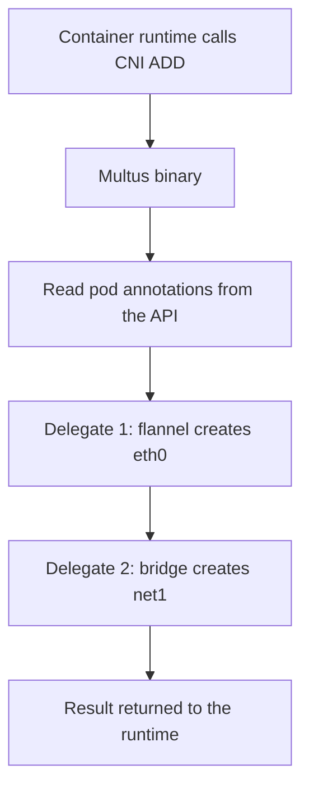

# How Multus Adds Interfaces

The CNI contract says that the container runtime reads one configuration file for a node and calls the plugin it names. That plugin, or the chain of plugins in a conflist, builds the network of a pod. The result is one pod network with one main interface. Kubernetes has no field in the pod specification for a second network. Multus solves this without changing Kubernetes: it is itself a CNI plugin, and its job is to call other CNI plugins.

## Multus is a meta plugin

A plugin that calls other plugins is called a meta plugin. When the runtime calls Multus with `ADD`, Multus does not build an interface on its own. It decides which other plugins to call, calls them one after another, and collects their results. The plugins that it calls are called delegates.

Multus builds the list of delegates from two sources:

- The default network. This is the network that the cluster plugin sets up. In the playground it is flannel. Multus takes the configuration of the cluster plugin and calls it first. The interface that this delegate creates is `eth0`, and its address comes from the node pod range.
- The additional networks. These are named in an annotation of the pod. Multus reads the annotation, looks up the matching NetworkAttachmentDefinition objects, and calls the plugin of each one. The interfaces get the names `net1`, `net2` and so on, in the order of the annotation.

The default network is always called, even when the pod has no annotation. A pod that does not ask for extra networks therefore looks the same as it would without Multus.

## How the node files change

Without Multus the directory `/etc/cni/net.d` on a node holds the file of the cluster plugin, for example `10-flannel.conflist`. The runtime reads the first file in lexical order. With Multus installed, a DaemonSet writes a Multus configuration file into the same directory. The file name starts with `00-`, so the runtime sorts it first and calls Multus instead of flannel.

In the automatic mode that the playground uses, the installer reads the cluster plugin configuration that it finds in the directory and builds the Multus file from it. The Multus file names the cluster plugin as the default network and holds the path of a kubeconfig, so that Multus can talk to the Kubernetes API. The kubeconfig lives in a directory that the Multus DaemonSet writes on the node. Multus needs API access for two reasons: to read the pod and its annotations, and to read NetworkAttachmentDefinition objects.

The Multus binary is copied to `/opt/cni/bin` on the node. The other plugins that Multus calls, such as `bridge` and `host-local`, must be in the same directory.



The diagram shows that the whole sequence happens inside one CNI call. The pod sandbox is ready only when every delegate has succeeded. If one delegate fails, the whole call fails and the pod stays in `ContainerCreating`.

## What each additional network is

An additional network is not a Kubernetes object that Services or DNS know about. It is a link between the pod and some other network. The `bridge` plugin creates a Linux bridge on the node, adds one end of a virtual Ethernet pair to the bridge and puts the other end into the pod as `net1`. The `host-local` plugin hands out an address from a range that you set.

Because the node creates the bridge, pods on the same node and on the same attachment can reach each other through it. Pods on different nodes are not connected by this bridge, because nothing carries the traffic between the bridges. If you need pods on different nodes to talk over an additional network, you must use a plugin that has an outside connection, such as `macvlan` on a real network interface.

Kubernetes Services do not use the additional interface. The Service address works only on the default network, and DNS answers with the default address of a pod. The additional address is known only to the pod and to the workloads that use it directly.

## Look at the node on the playground

<!-- astrona:playground:renew -->

List the DaemonSet that installs Multus and see that it runs on both nodes:

```sh
kubectl -n kube-system get daemonset kube-multus-ds
```

Start a debug pod on a node and list the files in the CNI configuration directory. Replace `NODE` with a name from `kubectl get nodes`.

```sh
kubectl debug node/NODE -it --image=busybox:1.37.0 -- ls /host/etc/cni/net.d
```

Find the file with the prefix `00-` and the flannel file next to it. The first file in the sorted list is the one that the runtime uses.

List the plugins that Multus can call:

```sh
kubectl debug node/NODE -it --image=busybox:1.37.0 -- ls /host/opt/cni/bin
```

The list holds `multus` next to `bridge`, `host-local` and the other plugins that the playground installed.

## The thin plugin and the API

Multus v4 has a thin plugin design. The binary on the node is small: it takes the call from the runtime, reads the pod from the API with the kubeconfig that the installer wrote, and calls the delegates. The playground installs this form from the DaemonSet file of version v4.3.1. A second design exists, called thick, in which a long-running daemon does the work. The annotation syntax and the objects are the same in both, so the rest of this module applies to both.

## What stays the same

The pod specification does not change. The containers, probes, volumes and resource requests are the same as for a pod without extra networks. Only one annotation is added. The scheduler does not know about the extra network either, so it can place the pod on any node. If the extra network exists only on some nodes, the pod must be placed on those nodes with a `nodeSelector`, otherwise the attachment can fail on a node that lacks the plugin or the bridge.

The pod keeps its default route on `eth0`. Additional interfaces get a route only for their own range, unless the attachment asks for the default route to move.

## Common pitfalls

> [!WARNING]
> Do not delete or edit the `00-` file on a node by hand. The Multus DaemonSet writes it, and removing it makes the runtime call flannel directly, so pods lose the additional interfaces without any error. Also remember that the first interface of every pod comes from the default network. If `eth0` is broken, the fault is in the cluster network plugin and not in the additional attachments.
