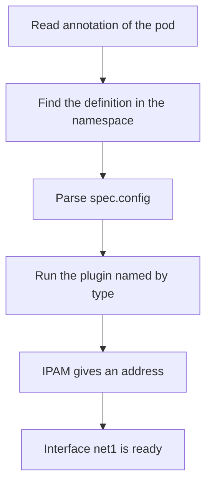

# Reading Attachment Failures

When an attachment fails, the pod does not crash. It never starts. The kubelet asks the runtime to create the pod sandbox, the runtime calls the CNI plugin, and the plugin returns an error. The kubelet tries again after a pause, and the pod shows the same status for as long as the fault lasts. To repair the pod you must first learn which step of the call failed.

## The symptom

A pod with a broken attachment has these signs:

- The status in `kubectl get pods` is `ContainerCreating` and does not change.
- The pod has no address, so the column `IP` is empty or shows `<none>`.
- The events of the pod contain a warning with the reason `FailedCreatePodSandBox`.
- Other pods on the same node, and pods without the annotation, start normally.

The last point is the key clue. If every new pod on a node fails, the fault is in the default network. If only the pods with the annotation fail, the fault is in the attachment.

## The steps of the call

Multus runs these steps inside one CNI call. A fault stops the call at one of them:

1. Multus reads the pod from the API and its annotation `k8s.v1.cni.cncf.io/networks`. A malformed annotation fails here.
2. Multus looks up each named NetworkAttachmentDefinition in the namespace of the pod, or in the namespace that the annotation names. A missing object fails here.
3. Multus reads `spec.config` of the object. Invalid JSON fails here.
4. Multus runs the delegate with the `type` of the configuration. A plugin that is not in `/opt/cni/bin` fails here.
5. The delegate builds the interface and asks its IPAM plugin for an address. An exhausted range or a bad IPAM setting fails here.

The default network runs first, so the pod has `eth0` in the sandbox when an additional delegate fails. The runtime still treats the whole call as failed, removes what was built and reports the error to the kubelet.



## Where the error text appears

The text of the error is returned from the plugin to the runtime and then to the kubelet, which writes it into the event. Read it with `kubectl describe pod`. The message of the event names the object or the plugin that failed. A definition that does not exist is named in the message, and a plugin type that does not exist is named in the message too. Read the message to the end, because the useful part comes after the generic text.

You can also list the events of a namespace sorted by time. This is useful when you do not know which pod is affected:

```sh
kubectl get events -n starfleet --sort-by=.lastTimestamp
```

The logs of the Multus DaemonSet pods show the installation work on the node. They do not show the result of a single pod call, because the plugin runs inside the runtime process of the node and returns its errors through the event.

## Check the causes in a fixed order

Check the cheapest and most common causes first:

1. Does the definition exist in the namespace of the pod? Run `kubectl -n NAMESPACE get net-attach-def`.
2. Does the name in the annotation match the name of the object? Compare character by character.
3. Is the JSON in `spec.config` valid and does it name a real plugin in `type`?
4. Is the plugin binary on the node? List `/opt/cni/bin` with a debug pod.
5. Is the range of the IPAM plugin large enough and written correctly?

## Try it on the playground

<!-- astrona:playground:renew -->

Two pods are stuck. List them:

```sh
kubectl get pods -A -o wide | grep -E 'ferry|cutter'
```

Read the events of the pod `ferry` and look for the name of the object that was not found:

```sh
kubectl -n outpost describe pod ferry
```

Check whether that object exists in the namespace of the pod and in the other namespace:

```sh
kubectl -n outpost get net-attach-def
kubectl -n starfleet get net-attach-def
```

Now do the same for `cutter`. Its definition exists, so the fault is inside the object. Read the configuration:

```sh
kubectl -n starfleet describe pod cutter
kubectl -n starfleet get net-attach-def dock-net -o jsonpath='{.spec.config}'
```

Compare the value of `type` with the plugins that are installed on a node. Replace `NODE` with a node name:

```sh
kubectl debug node/NODE -it --image=busybox:1.37.0 -- ls /host/opt/cni/bin
```

The plugin named in `dock-net` is not in the list.

## Common pitfalls

> [!WARNING]
> Do not fix an attachment by changing the default network. If the pod events show a fault with the definition or the plugin type, flannel is not involved, and editing the flannel files or the Multus file on the node can break every pod of the node. Change only the definition or the pod.
