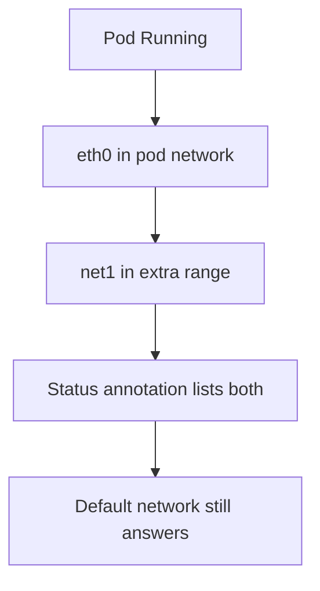

# Repairing Attachments And Checking Results

After you know which step failed, the repair is small. This part lists the repair for each fault, explains why the pod must often be created again, and shows how to prove that the pod has the interfaces that it asked for.

## Repair by cause

**The definition does not exist in the namespace of the pod.** Either create the definition in that namespace, or change the annotation of the pod to `namespace/name` so that it points at the existing object. The first choice keeps each namespace independent. The second choice needs a cluster that allows cross-namespace references.

**The name in the annotation is wrong.** A pod that names `uplink` when the object is `uplink-net` does not find it. Fix the name in the pod specification.

**The plugin type is wrong.** The `type` field must name a binary in `/opt/cni/bin`. A spelling mistake such as `bridg` is enough. Fix the value in `spec.config` with `kubectl edit` or `kubectl apply`. The name of a plugin that is missing on the node needs the binary to be installed on every node.

**The JSON is invalid.** Copy the value of `spec.config` to a file and check it with a JSON tool before you apply it again. The most common mistakes are single quotes inside the JSON, a missing comma and a trailing comma.

**The range is exhausted or wrong.** Check the `subnet` and `rangeStart` and `rangeEnd` values of the `host-local` block. A range that is too small runs out of addresses. A range that is not a valid CIDR fails at once.

## Why the pod is created again

The annotation is read when the sandbox is created, and the kubelet tries again with the same pod. For some faults, such as a definition that was created late, a retry of the kubelet can succeed on its own after a pause. This is not reliable and can take minutes.

The deterministic way is to delete the pod and create it again from the same manifest, with the fixed annotation if the annotation was wrong. If the pod belongs to a Deployment, change the pod template. The Deployment then replaces the pods itself.

```sh
kubectl -n NAMESPACE delete pod NAME
kubectl apply -f pod.yaml
```

The address that the failed pod held is released when the call fails, so the new pod does not run into an exhausted range because of the old one.

## Check the result

A repair is done only when the following checks pass:

- The pod is `Running` and `Ready`.
- `ip -4 addr` inside the pod shows `eth0` with a pod network address and the additional interface with an address from the range of the definition.
- The annotation `k8s.v1.cni.cncf.io/network-status` lists both networks.
- Pods that were fine before still work. Run a request from a client to the `probe` Service to prove that the default network was not harmed.



## Try it on the playground

<!-- astrona:playground:renew -->

Repair `ferry`. Its definition `side-net` exists in `starfleet` and is missing in `outpost`. Create the same definition in `outpost`:

```sh
kubectl apply -f - <<'YAML'
apiVersion: k8s.cni.cncf.io/v1
kind: NetworkAttachmentDefinition
metadata:
  name: side-net
  namespace: outpost
spec:
  config: '{"cniVersion": "1.0.0", "type": "bridge", "bridge": "side0", "ipam": {"type": "host-local", "subnet": "192.168.60.0/24"}}'
YAML
```

Repair `cutter`. Correct the plugin type in `dock-net`:

```sh
kubectl apply -f - <<'YAML'
apiVersion: k8s.cni.cncf.io/v1
kind: NetworkAttachmentDefinition
metadata:
  name: dock-net
  namespace: starfleet
spec:
  config: '{"cniVersion": "1.0.0", "type": "bridge", "bridge": "dock0", "ipam": {"type": "host-local", "subnet": "192.168.70.0/24"}}'
YAML
```

Wait and watch the pods. If a pod does not start, delete it and create it again with the same annotation:

```sh
kubectl get pods -A -w
```

When both pods run, check the interfaces and the default network:

```sh
kubectl -n outpost exec ferry -- ip -4 addr
kubectl -n starfleet exec cutter -- ip -4 addr
kubectl -n starfleet exec shuttle -- curl -s -m 5 -o /dev/null -w '%{http_code}\n' http://probe:9898/healthz
```

## Common pitfalls

> [!WARNING]
> Do not read a running pod as proof of a good attachment. A pod that has no annotation runs fine without any extra interface. Always check that the extra interface exists inside the pod with `ip -4 addr`. Also do not give two networks the same bridge name and a different range by mistake, because both attachments then share one Linux bridge on the node.
